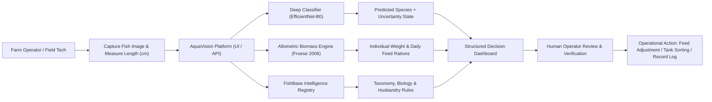
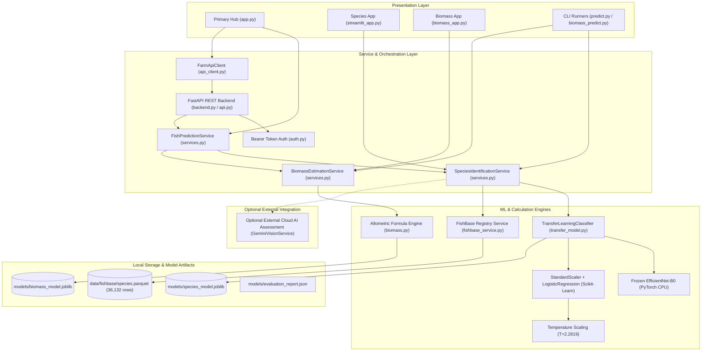
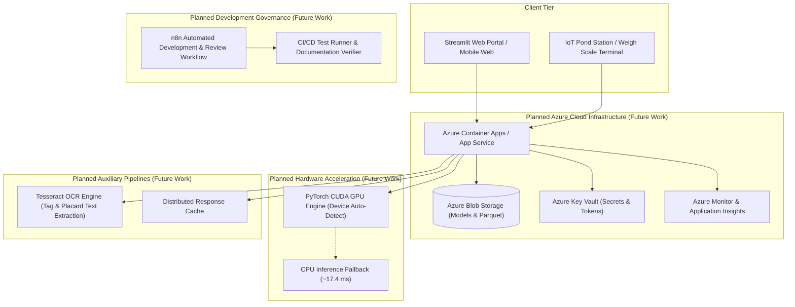
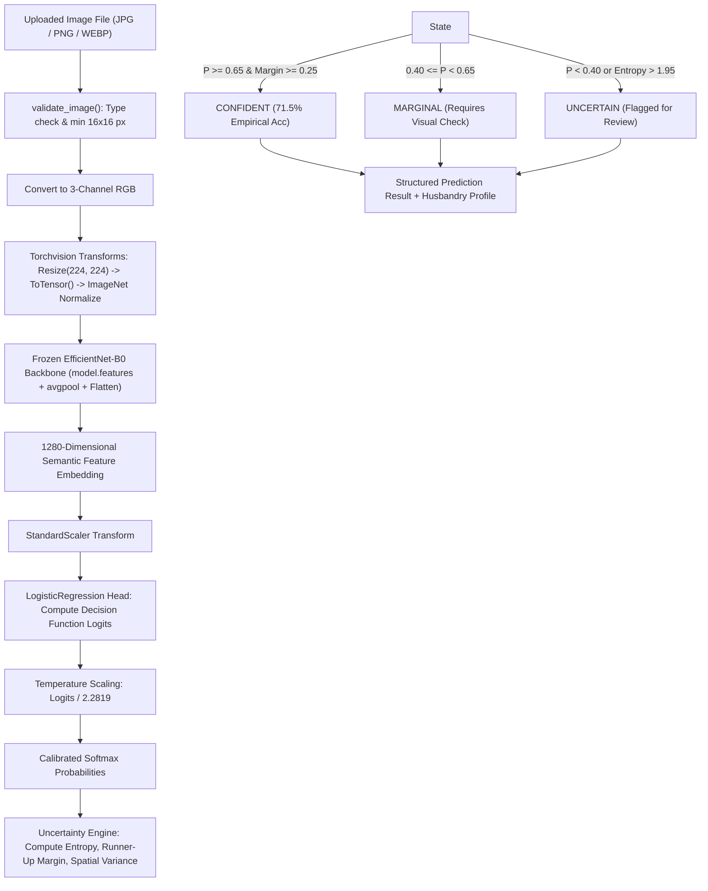
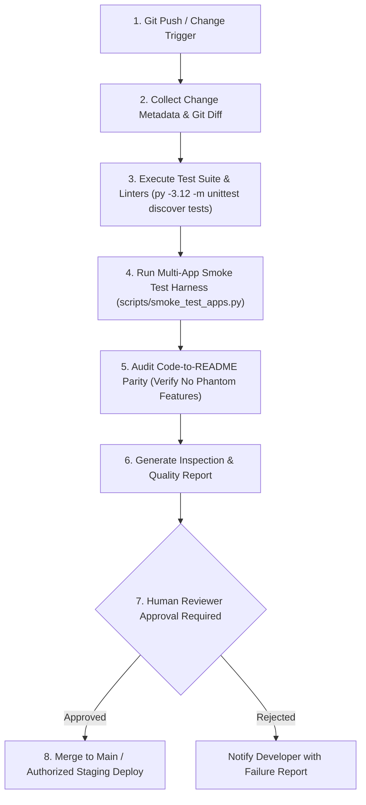

# AquaVision: AI-Enabled Aquaculture Decision-Support Platform

[](file:///d:/S5%20Mini%20project/pyproject.toml)
[](file:///d:/S5%20Mini%20project/data/fishbase/species.parquet)
[](file:///d:/S5%20Mini%20project/requirements.txt)
[](file:///d:/S5%20Mini%20project/app.py)
[](file:///d:/S5%20Mini%20project/backend.py)
[](file:///d:/S5%20Mini%20project/tests)

AquaVision is an AI-enabled aquaculture decision-support platform designed to improve operational visibility, feeding accuracy, and stock management in commercial fish farming and aquatic research. The platform combines deep transfer learning for fish species identification, peer-reviewed allometric biomass modeling, and a searchable global reference registry indexing 36,132 fish species.

> **Mandatory Event Alignment (AI for Business)**: AquaVision addresses operational inefficiencies in aquaculture—including feed misallocation, manual sorting bottlenecks, and inventory opacity—by providing a human-in-the-loop decision-support tool. It bridges the gap between raw biological vision models and commercial farm management. All economic benefits and operational efficiencies described in this document represent **intended targets and engineering hypotheses** requiring validation in on-farm commercial trials.

---

## Table of Contents

1. [Executive Summary & Business Value Proposition](#1-executive-summary--business-value-proposition)
2. [Business-to-Technology Mapping](#2-business-to-technology-mapping)
3. [Architecture Diagrams](#3-architecture-diagrams)
   - [Business Decision-Support Workflow](#business-decision-support-workflow)
   - [Implemented Current System Architecture](#implemented-current-system-architecture)
   - [Target Future Architecture](#target-future-architecture)
4. [Technology Stack](#4-technology-stack)
5. [Backend ML/DL Architecture](#5-backend-mldl-architecture)
   - [Classification Head Architecture Verification: Logistic Regression](#classification-head-architecture-verification-logistic-regression)
   - [Hybrid Transfer Learning Pipeline](#hybrid-transfer-learning-pipeline)
   - [Inference Pipeline Flowchart](#inference-pipeline-flowchart)
   - [Preprocessing & Feature Extraction](#preprocessing--feature-extraction)
   - [Calibrated Head & Temperature Scaling](#calibrated-head--temperature-scaling)
   - [Uncertainty Estimation Engine](#uncertainty-estimation-engine)
6. [Image Processing & Planned OCR](#6-image-processing--planned-ocr)
   - [Implemented Computer Vision Pipeline](#implemented-computer-vision-pipeline)
   - [Planned: Tesseract OCR Engine (Future Work)](#planned-tesseract-ocr-engine-future-work)
7. [Biomass Estimation & Population Aggregation](#7-biomass-estimation--population-aggregation)
   - [Verified Fisheries Allometric Formula](#verified-fisheries-allometric-formula)
   - [Experimental Length-Girth Approximation](#experimental-length-girth-approximation)
   - [Batch Population & Feed Ration Aggregator](#batch-population--feed-ration-aggregator)
   - [Physical Calibration Notice](#physical-calibration-notice)
8. [FishBase Global Species Intelligence Registry](#8-fishbase-global-species-intelligence-registry)
9. [Model Evaluation & Empirical Benchmark Results](#9-model-evaluation--empirical-benchmark-results)
   - [Zero-Observer-Overlap Partitioning Protocol](#zero-observer-overlap-partitioning-protocol)
   - [Candidate Cross-Validation Benchmarks](#candidate-cross-validation-benchmarks)
   - [Held-Out Test Set Performance](#held-out-test-set-performance)
   - [Confusion Matrix & Error Analysis](#confusion-matrix--error-analysis)
   - [Empirical Uncertainty Validation](#empirical-uncertainty-validation)
10. [Evaluation Framework & Business KPIs](#10-evaluation-framework--business-kpis)
11. [Software Engineering & API Architecture](#11-software-engineering--api-architecture)
12. [Caching & Performance Engineering](#12-caching--performance-engineering)
13. [Hardware & Cloud Roadmap](#13-hardware--cloud-roadmap)
    - [Planned GPU / CUDA Strategy (Future Work)](#planned-gpu--cuda-strategy-future-work)
    - [Planned Azure Cloud Deployment Architecture (Future Work)](#planned-azure-cloud-deployment-architecture-future-work)
14. [Planned n8n Development & Governance Automation](#14-planned-n8n-development--governance-automation)
15. [Security, Privacy, and Data Governance](#15-security-privacy-and-data-governance)
16. [Installation and Quick Start Guide](#16-installation-and-quick-start-guide)
17. [Verification, Smoke Tests, and Reproduction](#17-verification-smoke-tests-and-reproduction)
18. [Repository Structure](#18-repository-structure)
19. [Limitations, Roadmap, and Business Hypotheses](#19-limitations-roadmap-and-business-hypotheses)

---

## 1. Executive Summary & Business Value Proposition

### The Aquaculture Problem
Global aquaculture represents over 50% of total seafood production, yet operational decisions on small- to medium-sized fish farms frequently rely on manual inspection, uncalibrated visual estimation, and fragmented paper logs. This leads to three significant operational bottlenecks:
1. **Feed Misallocation & Economic Waste**: Feed represents 50% to 70% of total operational expenditure in finfish farming. Overfeeding causes high Feed Conversion Ratios (FCR) and water fouling; underfeeding stunts growth and extends production cycles. *(Operational Target: Reduce feed wastage via structured biomass-linked feeding schedules)*.
2. **Species Sorting Bottlenecks**: Mixed fingerling stocks (e.g., polyculture ponds or hatchery sorting) require labor-intensive manual classification, resulting in handling stress, physical injury, and increased juvenile mortality. *(Operational Target: Accelerate batch sorting and reduce handling time)*.
3. **Information Fragmentation**: Commercial farm operators lack immediate, field-accessible reference data regarding optimal harvest weights, thermal tolerances, and feeding regimes across species. *(Operational Target: Streamline access to taxonomic and husbandry guidelines)*.

### The AquaVision Solution
AquaVision is an **AI-enabled decision-support platform** tailored for farm managers, pond technicians, hatchery operators, and aquaculture researchers. Instead of attempting universal autonomous control, AquaVision acts as an intelligent digital assistant providing:
- **Species Identification**: A calibrated deep transfer learning classifier identifying core aquaculture finfish species in real-time (~17.4–19.9 ms on standard CPU).
- **Allometric Biomass Estimation**: Scientifically grounded weight calculations derived from peer-reviewed fisheries equations, translating physical metric measurements into immediate feeding recommendations.
- **Taxonomic & Husbandry Intelligence**: Instant access to 36,132 finfish profiles via an in-memory FishBase registry, coupled with curated husbandry profiles for core commercial species.
- **Uncertainty-Aware Decision Support**: Three-tier prediction confidence states (`CONFIDENT`, `MARGINAL`, `UNCERTAIN`) paired with closed-world caveats to prevent automated overconfidence on unknown organisms.

```
┌─────────────────────────────────────────────────────────────────────────────────┐
│                            AquaVision Core Capabilities                         │
├────────────────────────┬───────────────────────────────┬────────────────────────┤
│ Implemented Today      │ Optional / Integration State  │ Planned Future Work    │
├────────────────────────┼───────────────────────────────┼────────────────────────┤
│ • EfficientNet-B0 (CPU)│ • Optional external cloud AI  │ • Azure Cloud hosting  │
│ • Logistic Regression  │   second opinion integration  │ • CUDA GPU batching    │
│   classification head  │   via decoupled REST wrapper  │ • Tesseract OCR reader │
│ • Calibrated softmax   │ • Dual client-server execution│ • n8n automation flow  │
│ • Allometric biomass   │   (Local vs. FastAPI Backend) │ • Distributed caching  │
│ • Batch feed planner   │                               │ • Field biomass trials │
│ • 36k FishBase parquet │                               │ • Automated CI/CD test │
│ • 23 unit tests pass   │                               │   regression harness   │
└────────────────────────┴───────────────────────────────┴────────────────────────┘
```

---

## 2. Business-to-Technology Mapping

AquaVision links concrete aquaculture business requirements directly to verified software components:

| Business Requirement | Technical Solution | Implementation Status | Intended Operational Value *(Target)* |
| :--- | :--- | :--- | :--- |
| **Species Verification & Hatchery Sorting** | EfficientNet-B0 deep feature extraction (1280-dim) + calibrated Logistic Regression head | **Implemented** ([src/fishfarm_ai/transfer_model.py](file:///d:/S5%20Mini%20project/src/fishfarm_ai/transfer_model.py)) | Intended to reduce manual identification errors, accelerate batch sorting of fingerling stocks, and flag out-of-scope images via uncertainty tiers. *(Target: lower sorting labor hours)*. |
| **Feeding Optimization & Biomass Audits** | Allometric power equation ($W = a \cdot L^b$) & batch population aggregator | **Implemented** ([src/fishfarm_ai/biomass.py](file:///d:/S5%20Mini%20project/src/fishfarm_ai/biomass.py)) | Converts caliper/board measurements into accurate weight and daily feed rations, aimed at reducing feed waste and improving FCR. *(Target: reduce feed misallocation)*. |
| **Taxonomic & Husbandry Guidance** | In-memory parquet search indexing 36,132 species from FishBase v25.04 | **Implemented** ([src/fishfarm_ai/fishbase_service.py](file:///d:/S5%20Mini%20project/src/fishfarm_ai/fishbase_service.py)) | Provides instant offline access to commercial utility, environmental ranges, and morphological attributes without internet access. *(Target: eliminate manual literature search time)*. |
| **Centralized Farm Data Access** | Decoupled REST API backend built on FastAPI with token-based authentication | **Implemented** ([src/fishfarm_ai/api.py](file:///d:/S5%20Mini%20project/src/fishfarm_ai/api.py)) | Enables multi-device integration across field tablets, desktop workstations, and IoT monitoring stations. *(Target: unified farm data access)*. |
| **Pond Tag & Placard Digitization** | Tesseract OCR engine for reading specimen boards, tank tags, and labels | **Planned (Future Work)** | Eliminates manual transcription errors from physical specimen tags and handwritten pond monitoring boards. *(Target: automated record ingestion)*. |
| **Scalable Multi-Site Farm Hosting** | Containerized deployment on Azure Container Apps / App Service with Blob Storage | **Planned (Future Work)** | Supports centralized multi-farm enterprise deployments with elastic scalability and high availability. *(Target: multi-site deployment readiness)*. |
| **High-Throughput Batch Processing** | PyTorch CUDA hardware acceleration with CPU fallback | **Planned (Future Work)** | Accelerates high-volume batch image processing and future on-farm video stream analysis. *(Target: scalable throughput)*. |
| **Development & Model Governance** | n8n workflow for automated inspection, test execution, and deployment approval | **Planned (Future Work)** | Enforces strict documentation-code parity, automated regression testing, and auditable production releases. *(Target: software quality assurance)*. |

---

## 3. Architecture Diagrams

### Business Decision-Support Workflow

AquaVision functions as a decision-support system with human review at each operational milestone:



### Implemented Current System Architecture

The verified current architecture consists of a decoupled presentation layer, modular application services, in-memory ML inference, and local serialized artifacts:



### Target Future Architecture

Planned infrastructure upgrades for enterprise deployment and automated governance (**Future Work**). Notice that the target production architecture remains fully self-contained without external foundation-model dependencies:



---

## 4. Technology Stack

Only verified technologies present in the repository dependencies and codebase are listed below:

| Technology / Library | Version Constraint | Role in AquaVision | Source Verification |
| :--- | :--- | :--- | :--- |
| **Python** | `>=3.10` (tested on 3.12) | Core execution runtime | [pyproject.toml](file:///d:/S5%20Mini%20project/pyproject.toml#L10) |
| **PyTorch (`torch`)** | `torchvision` backend | Deep feature extraction & tensor manipulation | [src/fishfarm_ai/transfer_model.py](file:///d:/S5%20Mini%20project/src/fishfarm_ai/transfer_model.py#L15) |
| **Torchvision** | Standard distribution | Pretrained `EfficientNet_B0_Weights.DEFAULT` & image transforms | [src/fishfarm_ai/transfer_model.py](file:///d:/S5%20Mini%20project/src/fishfarm_ai/transfer_model.py#L17) |
| **Scikit-Learn** | `>=1.5` | `StandardScaler`, `LogisticRegression`, `StratifiedGroupKFold` | [requirements.txt](file:///d:/S5%20Mini%20project/requirements.txt#L3) |
| **Streamlit** | `>=1.37` | Interactive web applications (`app.py`, `streamlit_app.py`, `biomass_app.py`) | [requirements.txt](file:///d:/S5%20Mini%20project/requirements.txt#L6) |
| **FastAPI** | `>=0.115` | High-performance REST API backend | [requirements.txt](file:///d:/S5%20Mini%20project/requirements.txt#L8) |
| **Uvicorn** | `>=0.30` | ASGI server running the FastAPI backend (`backend.py`) | [requirements.txt](file:///d:/S5%20Mini%20project/requirements.txt#L9) |
| **Pillow (`PIL`)** | `>=10.4` | Image decoding, resizing, and dimension validation | [requirements.txt](file:///d:/S5%20Mini%20project/requirements.txt#L4) |
| **Joblib** | `>=1.4` | Model bundle serialization (`models/*.joblib`) | [requirements.txt](file:///d:/S5%20Mini%20project/requirements.txt#L5) |
| **Pandas** | `>=2.2` | Data manipulation, evaluation tables, and metadata ingestion | [requirements.txt](file:///d:/S5%20Mini%20project/requirements.txt#L2) |
| **PyArrow** | Standard distribution | Parquet engine reading FishBase v25.04 dataset | [src/fishfarm_ai/fishbase_service.py](file:///d:/S5%20Mini%20project/src/fishfarm_ai/fishbase_service.py#L114) |
| **NumPy** | `>=1.26` | Mathematical arrays, entropy calculation, and metric arrays | [requirements.txt](file:///d:/S5%20Mini%20project/requirements.txt#L1) |
| **Requests** | `>=2.32` | HTTP client for `FarmApiClient` backend communication | [requirements.txt](file:///d:/S5%20Mini%20project/requirements.txt#L10) |

---

## 5. Backend ML/DL Architecture

### Classification Head Architecture Verification: Logistic Regression
> **IMPORTANT ARCHITECTURAL RESOLUTION**:
> Inspection of [src/fishfarm_ai/transfer_model.py](file:///d:/S5%20Mini%20project/src/fishfarm_ai/transfer_model.py#L13-L45), [src/fishfarm_ai/model.py](file:///d:/S5%20Mini%20project/src/fishfarm_ai/model.py#L238-L245), and the serialized model bundle `models/species_model.joblib` verifies that the active classifier head is **Logistic Regression (`sklearn.linear_model.LogisticRegression(max_iter=1000, random_state=42)`)**, preceded by `StandardScaler()`. 
> 
> **Ridge Regression (`RidgeClassifier`) is NOT used anywhere in the inference pipeline or active model bundle.** The classification probabilities are generated by applying out-of-fold calibrated Temperature Scaling to the `LogisticRegression.decision_function` logits.

### Hybrid Transfer Learning Pipeline
AquaVision utilizes a **hybrid deep learning and traditional machine learning architecture** rather than end-to-end backpropagation training:
1. **Sample Efficiency**: Deep CNN backbones require millions of labeled images to train from scratch. By utilizing an ImageNet-pretrained `EfficientNet-B0` backbone with frozen weights, AquaVision extracts generalized low- and mid-level visual features (edges, textures, silhouettes, and fin shapes).
2. **Defensible Linear Decision Boundaries**: Training a convex `LogisticRegression` head on extracted 1280-dimensional embeddings avoids overfitting on small, group-stratified datasets and produces reproducible decision surfaces.
3. **Calibrated Probability Outputs**: Raw neural network logits frequently suffer from overconfidence. AquaVision applies **Temperature Scaling ($T = 2.2819$)** to scale decision function logits prior to softmax calculation.

### Inference Pipeline Flowchart



### Preprocessing & Feature Extraction
- **Input Validation**: Verified by [validate_image](file:///d:/S5%20Mini%20project/src/fishfarm_ai/transfer_model.py#L20-L28). Rejects non-image inputs and images smaller than $16 \times 16$ pixels.
- **Normalization**: Standard ImageNet mean `[0.485, 0.456, 0.406]` and standard deviation `[0.229, 0.224, 0.225]`.
- **Backbone Execution**: Evaluated in `eval()` mode with `param.requires_grad = False` inside a `torch.no_grad()` context block.
- **Embedding Dimensionality**: Exactly 1280 floating-point features per image.

### Calibrated Head & Temperature Scaling
The classification head consists of an L2-regularized `LogisticRegression` model with `max_iter=1000`. Decision function logits $z$ are transformed into calibrated probabilities $p_i$ using:

$$p_i = \frac{e^{z_i / T}}{\sum_{j=1}^{C} e^{z_j / T}}$$

where the calibrated temperature parameter is $T = 2.2819$. An automatic safety fallback reverts to standard softmax if temperature scaling is disabled or $T = 1.0$.

### Uncertainty Estimation Engine
To protect aquaculture operations from erroneous automated decisions, AquaVision computes:
- **Runner-Up Margin**: $M = P_{(1)} - P_{(2)}$ (difference between top probability and runner-up).
- **Predictive Shannon Entropy**: $H = -\sum_{i=1}^{C} p_i \log_2(p_i)$ bits.
- **Spatial Variance Filter**: Rejects uniform, low-texture, or non-fish inputs ($\sigma_{\text{spatial}} < 5.0$).
- **Closed-World Caveat**: Attached to all prediction outputs, stating that unsupported species or non-fish images will be categorized into one of the 5 supported classes.

---

## 6. Image Processing & Planned OCR

### Implemented Computer Vision Pipeline
The active computer vision pipeline focuses strictly on biological specimen representation:
- **RGB Decoding & Rescaling**: Standardizes multi-format uploads (JPEG, PNG, WEBP) to uniform 8-bit RGB color matrices.
- **Interpolation**: Bilinear resizing to $224 \times 224$ pixels matching EfficientNet-B0 reception fields.
- **Handcrafted Biological Descriptors (Phase 5 Baseline)**: Preserved in [src/fishfarm_ai/features.py](file:///d:/S5%20Mini%20project/src/fishfarm_ai/features.py) as an interpretable 75-dimensional baseline (RGB/HSV color moments, Sobel vertical/horizontal gradients, Laplacian texture scale, and Otsu contour bounding box morphology).

### Planned: Tesseract OCR Engine (**Future Work**)
Optical Character Recognition (OCR) using Tesseract is planned as an auxiliary documentation tool for physical aquaculture records.

> **CRITICAL DISTINCTION**: **Tesseract OCR is strictly an alphanumeric character extraction engine.** It is completely separate from computer vision, fish species classification, and biomass estimation. OCR cannot identify fish species from anatomy, cannot segment fish silhouettes, and cannot calculate geometric dimensions or weight.

#### Planned OCR Workflow
```
[Physical Document / Placard Image]
               │
               ▼
   [Image Preprocessing] ──▶ Grayscale, binarization, skew correction
               │
               ▼
    [Tesseract OCR Engine] ──▶ Character extraction from text regions
               │
               ▼
    [Parsed Text Parsing] ──▶ Tank ID, Batch #, Tag Date, Caliper Measurement
               │
               ▼
    [Human Verification] ──▶ Farm operator approves digitized record
```
*Current Repository Status*: Tesseract OCR is **not implemented** in the active codebase and is designated as a future extension.

---

## 7. Biomass Estimation & Population Aggregation

### Verified Fisheries Allometric Formula
AquaVision implements the peer-reviewed fisheries length-weight power equation:

$$W(\text{g}) = a \cdot L(\text{cm})^b$$

Converted to kilograms ($W_{\text{kg}} = W_{\text{g}} / 1000$). Parameters were verified against the Froese (2006) FishBase consensus:

| Species | $a$ (Condition factor) | $b$ (Allometric exponent) | Measurement Convention | Scientific Reference | Growth Characteristics & Limitations |
| :--- | :---: | :---: | :--- | :--- | :--- |
| **Nile Tilapia** (*Oreochromis niloticus*) | `0.0177` | `2.99` | Total Length (TL, cm) | Froese (2006); Schneider (1990) FAO | Near-isometric growth ($b \approx 3.0$). Satiation and gonad maturity cause $\pm 12\%$ variance. |
| **African Catfish** (*Clarias gariepinus*) | `0.0068` | `3.05` | Total Length (TL, cm) | Froese (2006); Teugels (1986) | Anguilliform profile with heavy bony head plate. Large specimens ($>50\text{ cm}$) exhibit slight positive allometry. |
| **Common Carp** (*Cyprinus carpio*) | `0.0153` | `3.01` | Total Length (TL, cm) | Froese (2006); Balon (1995) | Robust cyprinid body depth. Body depth varies substantially across mirror vs. scaly breeds. |
| **Milkfish** (*Chanos chanos*) | `0.0091` | `3.04` | Fork / Total Length (FL/TL, cm) | Froese (2006); Bagarinao (1991) SEAFDEC | Fusiform streamlined profile. Fork length converted to TL if caudal fin lobes are uneven. |
| **Pangasius** (*P. hypophthalmus*) | `0.0085` | `3.03` | Standard / Total Length (SL/TL, cm) | Froese (2006); Roberts & Vidthayanon (1991) | Commercial high-protein feed induces deeper abdominal belly curvature than wild riverine baselines. |
| *Generic Finfish Fallback* | `0.0140` | `3.00` | Total Length (TL, cm) | Generalized teleost cube law | Uncalibrated baseline for unlisted aquaculture teleosts. |

*Verified Calculation Example (Nile Tilapia at $L = 25.0\text{ cm}$)*:
$$W(\text{g}) = 0.0177 \times 25.0^{2.99} = 264.28\text{ g} \approx 0.264\text{ kg}$$

### Experimental Length-Girth Approximation
When girth measurements are available, the volumetric approximation formula is supported:

$$W(\text{g}) = \frac{L(\text{cm}) \cdot G(\text{cm})^2}{C_{\text{shape}}}$$

Shape divisor constants: Tilapia ($C=29.0$), Carp ($C=28.5$), Catfish ($C=38.0$), Milkfish ($C=34.0$), Pangasius ($C=35.0$). This method is explicitly flagged as **`experimental_length_girth_morphology`** and requires farm-specific calibration across growth cycles.

### Batch Population & Feed Ration Aggregator
To support pond-level feeding decisions, [estimate_batch_biomass](file:///d:/S5%20Mini%20project/src/fishfarm_ai/biomass.py#L200-L236) aggregates individual measurements into population metrics:
- **Effective Fish Count**: $N_{\text{eff}} = \text{round}\left(N_{\text{stock}} \times \frac{\text{Survival \%}}{100}\right)$
- **Total Pond Biomass (kg)**: $B_{\text{total}} = W_{\text{indiv (kg)}} \times N_{\text{eff}}$
- **Recommended Daily Feed (kg)**: $\text{Feed}_{\text{daily}} = B_{\text{total}} \times \frac{\text{Feed Rate \%}}{100}$

*Verified Batch Example*: 
Given 1,000 stocked tilapia, an assumed 95.0% survival rate, an average measured individual weight of 0.264 kg, and a daily feed rate of 2.5%:
- $N_{\text{eff}} = 950\text{ fish}$
- $B_{\text{total}} = 0.264\text{ kg} \times 950 = 250.8\text{ kg}$
- $\text{Feed}_{\text{daily}} = 250.8\text{ kg} \times 0.025 = 6.27\text{ kg/day}$

### Physical Calibration Notice
> **METHODOLOGICAL REQUIREMENT**: Length ($L$) and girth ($G$) are **manual physical inputs (cm)** obtained using calipers, measuring troughs, or calibrated boards. **Ordinary 2D camera images CANNOT determine metric length or weight** without physical scale calibration markers.

---

## 8. FishBase Global Species Intelligence Registry

AquaVision integrates a complete offline index of the **FishBase v25.04 Species Registry** (`data/fishbase/species.parquet`):
- **Coverage**: 36,132 verified fish species across freshwater, brackish, and marine habitats.
- **Storage & Parsing**: Stored in Apache Parquet format (Snappy compression) and queried via PyArrow / Pandas.
- **Fields Indexed**: `SpecCode`, `Genus`, `Species`, `FBname` (Common Name), `Author`, `FamCode`, `BodyShapeI`, `Fresh`, `Brack`, `Saltwater`, `DemersPelag`, `Length`, `CommonLength`, `Weight`, `UsedforAquaculture`, `Comments`.
- **Search Engine**: Case-insensitive substring search matching across scientific binomial names, common names, and genus. Includes an aquaculture filter targeting species with documented commercial or experimental utility.
- **Caching Mechanism**: Eagerly parsed on first invocation and cached in an in-memory singleton (`get_fishbase_service()`), eliminating repeated disk reads.
- **Intellectual Property & Licensing**:
  > *Data source: FishBase v25.04 (Froese & Pauly, 2025). Distributed under Creative Commons Attribution-NonCommercial 4.0 (CC BY-NC 4.0). Academic and non-commercial research use only; not cleared for unrestricted commercial operational use.*

---

## 9. Model Evaluation & Empirical Benchmark Results

### Zero-Observer-Overlap Partitioning Protocol
To eliminate evaluation data leakage—where photos from the same observer, camera sensor, or collection trip appear in both training and testing sets—the dataset was partitioned using `StratifiedGroupKFold`:
- **Source**: GBIF / iNaturalist research-grade observations (500 verified images; exactly 100 per species).
- **Group Identifier**: Unique observer identifier (`recorded_by`) across 394 unique observers.
- **Held-Out Test Set**: 125 images (25 per species) across 97 observers.
- **Observer Overlap Count**: **EXACTLY 0**. No photographer identifier overlaps between training and evaluation partitions.

### Candidate Cross-Validation Benchmarks
Architectures were evaluated using **5-Fold Group-Stratified Cross-Validation on the 375 training samples** (0 observer overlap across folds):

| Model Architecture | Feature Dims | 5-Fold CV Accuracy | 5-Fold CV Macro F1 | Test Accuracy (125 Unseen) | Test Macro F1 | Feature Vector Infer Latency | End-to-End CPU Latency | Model Size | Selection Decision |
| :--- | :---: | :---: | :---: | :---: | :---: | :---: | :---: | :---: | :--- |
| **HistGradientBoosting (Baseline)** | 75 | 36.53% ± 2.75% | 0.3595 ± 0.0212 | 33.60% (42/125) | 0.3362 | 0.080 ms | ~0.08 ms | **0.8 MB** | Phase 5 Handcrafted Baseline |
| **MobileNetV3-Small (Transfer)** | 576 | 52.00% ± 4.54% | 0.5133 ± 0.0453 | *N/A (Screened out during CV)* | *N/A* | 0.006 ms | ~6.4 ms | 10.2 MB | Candidate (+15.47% CV Acc over baseline) |
| **EfficientNet-B0 (Transfer)** | **1280** | **64.00% ± 4.99%** | **0.6309 ± 0.0526** | **68.00% (85/125)** | **0.6735** | **0.007 ms** | **~17.4–19.9 ms** | 20.5 MB | **WINNER (Selected & Deployed)** |

*Methodological Note on Evaluation*: Per the evaluation protocol in [src/fishfarm_ai/model.py](file:///d:/S5%20Mini%20project/src/fishfarm_ai/model.py#L302-L325), candidate models were screened during 5-fold cross-validation. MobileNetV3-Small was not selected for final fitting on the full 375 training pool; therefore, it was not evaluated on the held-out test partition. Only the winning model (EfficientNet-B0) and the baseline (HistGradientBoosting) were evaluated on the untouched 125 test set.

### Held-Out Test Set Performance
Evaluated once on the untouched held-out test partition of **125 unseen real images** (25 per class, 0 observer overlap):

| Target Species | Baseline Precision | Baseline Recall | Baseline F1 | **EfficientNet-B0 Precision** | **EfficientNet-B0 Recall** | **EfficientNet-B0 F1** | **F1 Gain** |
| :--- | :---: | :---: | :---: | :---: | :---: | :---: | :---: |
| **Milkfish** (*C. chanos*) | 0.520 | 0.520 | 0.520 | **0.778** | **0.840** | **0.808** | **+0.288** |
| **Pangasius** (*P. hypophthalmus*) | 0.308 | 0.320 | 0.314 | **0.826** | **0.760** | **0.792** | **+0.478** |
| **Tilapia** (*O. niloticus*) | 0.292 | 0.280 | 0.286 | **0.727** | **0.640** | **0.681** | **+0.395** |
| **Catfish** (*C. gariepinus*) | 0.333 | 0.320 | 0.327 | **0.588** | **0.800** | **0.678** | **+0.351** |
| **Carp** (*C. carpio*) | 0.231 | 0.240 | 0.235 | **0.474** | **0.360** | **0.409** | **+0.174** |
| **Macro Average** | **0.337** | **0.336** | **0.336** | **0.679** | **0.680** | **0.674** | **+0.337** |

### Confusion Matrix & Error Analysis

```text
               Predicted
            carp  catfish  milkfish  pangasius  tilapia
carp           9        6         4          2        4
catfish        2       20         1          1        1
milkfish       2        1        21          0        1
pangasius      1        5         0         19        0
tilapia        5        2         1          1       16
```
- **Catfish & Milkfish**: Achieved high sensitivity (Recall: 80.0% and 84.0%) due to distinct anguilliform and silvery fusiform profiles.
- **Pangasius**: Achieved high precision (82.6%) with minor confusion with juvenile catfish.
- **Carp Confusion**: Carp exhibited lower recall (36.0%), frequently confused with catfish and tilapia under murky water or extreme top-down viewing angles.

### Empirical Uncertainty Validation
Measured out-of-fold across 375 cross-validation samples:
- **`CONFIDENT` Tier** ($P \ge 0.65, \text{margin} \ge 0.25$): 302 samples (80.5% of predictions) | **Empirical Accuracy: 71.52%** (Error rate: 28.48%).
- **`MARGINAL` Tier** ($0.40 \le P < 0.65$): 52 samples (13.9% of predictions) | **Empirical Accuracy: 32.69%** (Error rate: 67.31%).
- **`UNCERTAIN` Tier** ($P < 0.40$ or $H > 1.95$ bits): 21 samples (5.6% of predictions) | **Empirical Accuracy: 33.33%** (Flagged for operator review).

---

## 10. Evaluation Framework & Business KPIs

AquaVision's performance is measured across three distinct tiers connecting technical metrics to business outcomes:

```
┌────────────────────────────────────────────────────────────────────────┐
│                        Three-Tier Evaluation Framework                 │
├──────────────────────────┬────────────────────────┬────────────────────┤
│ Tier 1: AI/ML Metrics    │ Tier 2: Engineering    │ Tier 3: Business   │
│ (Empirically Measured)   │ (Empirically Measured) │ (Proposed Targets) │
├──────────────────────────┼────────────────────────┼────────────────────┤
│ • Macro F1-Score (0.6735)│ • Feature infer time   │ • Task completion  │
│ • Test Accuracy (68.0%)  │   (0.007 ms)           │   time vs. manual  │
│ • Zero-leakage CV F1     │ • End-to-end CPU time  │ • Projected FCR    │
│ • Biomass Train MAE      │   (~17.4–19.9 ms)      │   optimization     │
│   (0.31 g on ref data)   │ • Memory Usage (<1 GB) │ • User acceptance  │
└──────────────────────────┴────────────────────────┴────────────────────┘
```

> **Evaluation Disclaimer**: Tier 1 and Tier 2 metrics are empirically verified by test reports and benchmarks. Tier 3 metrics represent **hypothesized commercial evaluation targets** to be measured during prospective farm pilot trials.

### Proposed Biomass Field Validation Plan (**Future Work**)
While the current allometric model is verified against Froese (2006) literature parameters, practical farm adoption requires field validation:
1. **Sampling Protocol**: Sample 50 live specimens per species across three distinct growth phases (nursery fingerlings, grow-out juveniles, pre-harvest adults).
2. **True Weight Measurement**: Measure wet weight using digital balances ($\pm 0.1\text{ g}$).
3. **Target Metrics**: Measure Mean Absolute Error (MAE), Root Mean Squared Error (RMSE), and Mean Absolute Percentage Error (MAPE). Target operational threshold: $\text{MAPE} \le 8.0\%$.

---

## 11. Software Engineering & API Architecture

AquaVision is structured as a **modular monolith** with clear separation of concerns:

- **Decoupled Backend**: [backend.py](file:///d:/S5%20Mini%20project/backend.py) launches a standalone FastAPI application via Uvicorn on port `8000`.
- **REST Endpoints**:
  - `GET /health`: Health status and authentication configuration check.
  - `POST /auth/login`: Validates credentials and returns a Bearer access token.
  - `POST /species/predict`: Accepts base64 image bytes; returns predicted species, calibrated scores, and uncertainty states.
  - `POST /biomass/predict`: Accepts species and metric measurements; returns estimated weight.
  - `POST /predict`: Combined endpoint accepting image bytes and length/girth measurements.
- **Typed API Client**: [src/fishfarm_ai/api_client.py](file:///d:/S5%20Mini%20project/src/fishfarm_ai/api_client.py) (`FarmApiClient`) provides a Python interface for remote backend calls with automatic base64 encoding and error handling.
- **Dual Execution Mode**: [app.py](file:///d:/S5%20Mini%20project/app.py) features a sidebar toggle allowing operators to switch between direct local Python module execution and remote FastAPI execution.

---

## 12. Caching & Performance Engineering

### Implemented Caching Mechanisms
1. **Model Bundle Caching**: [app.py](file:///d:/S5%20Mini%20project/app.py#L171-L179) utilizes Streamlit's `@st.cache_resource` decorator to cache the loaded `SpeciesModelBundle` and `BiomassModelBundle` in memory across browser interactions, eliminating repeated disk deserialization.
2. **FishBase In-Memory Singleton**: [src/fishfarm_ai/fishbase_service.py](file:///d:/S5%20Mini%20project/src/fishfarm_ai/fishbase_service.py#L251-L261) implements `_GLOBAL_FISHBASE_SERVICE`, caching the 36,132-row DataFrame in RAM after initial read.
3. **Pre-Computed Search Indexes**: Search queries execute against a pre-concatenated lowercase string index (`_search_index`), eliminating repeated string formatting during exploration.

### Planned Caching Improvements (**Future Work**)
- **Distributed API Response Cache**: In-memory key-value caching (e.g., hash-based caching on image bytes) for high-frequency API prediction queries.
- **Bounded Memory Eviction**: Implementation of LRU cache bounds to prevent memory bloat during multi-user sessions.

---

## 13. Hardware & Cloud Roadmap

### Planned GPU / CUDA Strategy (**Future Work**)
- **Hardware Autodetection Design**:
  ```python
  device = torch.device("cuda" if torch.cuda.is_available() else "cpu")
  ```
- **Local Development Reality**: AquaVision runs entirely on **CPU** in local development. With CPU inference latency measured at **~17.4–19.9 ms per image**, a discrete GPU is **not required** for interactive use.
- **Development Hardware Constraint**: For local workstations equipped with an NVIDIA GeForce RTX 2050 (4 GB VRAM), CUDA acceleration must manage GPU memory carefully to avoid out-of-memory errors during concurrent batch processing.
- **Target Role for CUDA**: Reserved for batch re-embedding of tens of thousands of archive photos or future end-to-end deep fine-tuning.

### Planned Azure Cloud Deployment Architecture (**Future Work**)
The repository's decoupled structure supports containerized cloud deployment:
- **Container Compute**: Host FastAPI and Streamlit containers on **Azure Container Apps** or **Azure App Service**, enabling horizontal auto-scaling based on HTTP request volume.
- **Asset Storage**: Store large dataset artifacts (`species.parquet`) and model bundles in **Azure Blob Storage**, mounted or downloaded during container initialization.
- **Credential Protection**: Store API tokens and secrets in **Azure Key Vault** using Managed Identities.
- **Diagnostics & Monitoring**: Stream application metrics, inference latencies, and request volumes to **Azure Monitor & Application Insights**.
- **Local Isolation Rule**: **Cloud deployment and Azure services are NOT active in the local development setup.** Local operation remains strictly local on `localhost`.

---

## 14. Planned n8n Development & Governance Automation

To ensure continuous quality, documentation parity, and auditable releases, an **n8n workflow** is planned as a development automation tool:



> **Design Boundary**: n8n is an external development and deployment automation tool. It is **not a runtime dependency** for fish species classification or biomass calculations.

---

## 15. Security, Privacy, and Data Governance

1. **Zero Secret Exposure**: No API keys, database passwords, or private access tokens are committed to the repository. Authentication parameters are ingested via environment variables (`FISHFARM_API_TOKEN`, `FISHFARM_USERNAME`, `FISHFARM_PASSWORD`).
2. **Ephemeral Image Handling**: Images uploaded via web interfaces or API endpoints are processed in memory as byte streams and are not persisted to disk, protecting proprietary farm imagery.
3. **Input Sanitization**: File uploads are validated via Pillow and Pydantic schemas, enforcing size limits and rejecting corrupt binary payloads.
4. **Data Governance & Attribution**: The FishBase dataset is explicitly labeled with its Creative Commons Attribution-NonCommercial 4.0 (CC BY-NC 4.0) license. Commercial deployments must replace or license reference datasets accordingly.
5. **Decoupled Architecture Boundary**: The core platform operates independently without external foundation model dependencies. Any optional secondary assessment wrappers remain decoupled and disabled by default.

---

## 16. Installation and Quick Start Guide

### Prerequisites
- Windows, Linux, or macOS.
- **Python 3.10 to 3.12** installed (Python 3.12 verified).
- Git.

### 1. Clone & Set Up Virtual Environment

```powershell
# Clone the repository
git clone https://github.com/your-org/aquavision.git
cd "d:\S5 Mini project"

# Create a virtual environment using Python 3.12
py -3.12 -m venv .venv

# Activate the virtual environment (Windows PowerShell)
.venv\Scripts\Activate.ps1
```

### 2. Install Verified Dependencies

```powershell
pip install --upgrade pip
pip install -r requirements.txt
```

### 3. Verify Artifact Availability
Ensure the following artifacts exist in the repository tree:
- Model files: `models/species_model.joblib` and `models/biomass_model.joblib`.
- Evaluation audit: `models/evaluation_report.json`.
- FishBase registry: `data/fishbase/species.parquet`.

### 4. Launch the Applications

#### Primary AquaVision Decision Hub (Recommended)
Launches the full interactive multi-workflow portal:
```powershell
streamlit run app.py
```
*Access in browser at:* `http://localhost:8501`

#### Dedicated Single-Purpose Applications
```powershell
# Dedicated Species Classifier App
streamlit run streamlit_app.py --server.port 8502

# Dedicated Biomass Calculator App
streamlit run biomass_app.py --server.port 8503
```

#### FastAPI Backend Service
Launches the headless REST API backend:
```powershell
python backend.py
```
*API running at:* `http://localhost:8000` | *Interactive docs:* `http://localhost:8000/docs`

---

## 17. Verification, Smoke Tests, and Reproduction

AquaVision includes comprehensive automated testing harnesses:

### 1. Run Automated Unit Test Suite (23 Passing Tests)
Verifies image validation, model loading, biomass calculations, FishBase queries, and error handling:
```powershell
py -3.12 -m unittest discover tests
```
*Expected Output:*
```text
Ran 23 tests in ~3.7s
OK
```

### 2. Run Headless Multi-App Smoke Test Harness
Boots `app.py`, `streamlit_app.py`, and `biomass_app.py` in headless mode on isolated ports and polls health endpoints:
```powershell
py -3.12 scripts/smoke_test_apps.py
```
*Expected Output:*
```text
SUCCESS: app.py responded HTTP 200 on http://127.0.0.1:8511/_stcore/health
SUCCESS: streamlit_app.py responded HTTP 200 on http://127.0.0.1:8512/_stcore/health
SUCCESS: biomass_app.py responded HTTP 200 on http://127.0.0.1:8513/_stcore/health
All 3 Streamlit applications passed smoke test successfully!
```

### 3. Run Command-Line Prediction Tests
```powershell
# Species inference CLI test
py -3.12 predict.py data/species_images/tilapia/tilapia_004.jpg

# Biomass calculation CLI test
py -3.12 biomass_predict.py --species tilapia --length-cm 25.0
```

---

## 18. Repository Structure

```text
d:\S5 Mini project\
├── app.py                     # Primary AquaVision Streamlit Portal (Workflows 1-5)
├── backend.py                 # FastAPI Uvicorn ASGI Entry Point (Port 8000)
├── biomass_app.py             # Dedicated Streamlit Biomass Calculator
├── biomass_predict.py         # Standalone CLI Biomass Prediction Runner
├── predict.py                 # Standalone CLI Species Prediction Runner
├── pyproject.toml             # Project Build Metadata & Packaging Config
├── requirements.txt           # Verified Project Dependencies
├── streamlit_app.py           # Dedicated Streamlit Species Identification UI
├── train.py                   # Model Training & Evaluation Audit Generator
├── data/
│   ├── fishbase/
│   │   └── species.parquet    # FishBase v25.04 Reference Dataset (36,132 rows)
│   ├── sample_biomass_records.csv # Reference Calibration Data for Biomass
│   └── species_images/        # 500 Verified GBIF Research Images (100 per species)
│       ├── carp/
│       ├── catfish/
│       ├── milkfish/
│       ├── pangasius/
│       ├── tilapia/
│       └── metadata.csv       # Observer ID Manifest for Leakage Prevention
├── models/
│   ├── biomass_model.joblib   # Trained Biomass Regression Bundle
│   ├── evaluation_report.json # Comprehensive Metrics, CV Benchmarks & Audits
│   └── species_model.joblib   # Pretrained EfficientNet-B0 + Calibrated Head Bundle
├── scripts/
│   ├── calibrate_model.py     # Temperature Scaling Calibration Script
│   ├── smoke_test_apps.py     # Headless Multi-Port Streamlit Smoke Test Runner
│   └── validate_uncertainty.py# Out-of-Fold Uncertainty Tier Validation Script
├── src/
│   └── fishfarm_ai/
│       ├── api.py             # FastAPI REST Endpoints & Pydantic Schemas
│       ├── api_client.py      # Typed FarmApiClient HTTP Client
│       ├── auth.py            # Bearer Token Authentication Helpers
│       ├── biomass.py         # Allometric Length-Weight & Batch Calculation Engine
│       ├── config.py          # Centralized Paths & Environment Constants
│       ├── features.py        # 75-dim Handcrafted Descriptors (Phase 5 Baseline)
│       ├── fishbase_service.py# In-Memory FishBase Parquet Search & Caching Service
│       ├── gemini_service.py  # Optional External Assessment Wrapper (Decoupled)
│       ├── model.py           # Dataclasses & Pipeline Bundles (Species / Biomass)
│       ├── pipeline.py        # Unified Image & Metric Prediction Pipelines
│       ├── services.py        # High-Level Service Interfaces & Uncertainty Logic
│       ├── species_intelligence.py # Husbandry Profiles for 5 Core Farm Species
│       └── transfer_model.py  # EfficientNet-B0 Pretrained Extractor & Calibrated Head
└── tests/
    ├── test_fishbase_service.py # Unit Tests for FishBase Parquet Service
    ├── test_gemini_service.py   # Unit Tests for External Assessment Wrapper
    └── test_pipeline.py         # Unit Tests for Pipeline, Biomass & Image Validation
```

---

## 19. Limitations, Roadmap, and Business Hypotheses

### Technical & Biological Limitations
1. **Closed-World Constraint**: The local image classifier is trained strictly on 5 core aquaculture finfish species. Non-fish objects or wild species will be forced into one of these classes. Operators must consult the uncertainty tier and the FishBase registry for unlisted species.
2. **Physical Measurement Requirement**: Allometric biomass calculation requires manual physical length measurements (cm). Monocular 2D images cannot determine metric dimensions without optical calibration markers.
3. **Biological Variance**: Allometric relationships represent statistical averages. Nutritional status, gonad maturity, and selective breeding introduce natural variance ($\pm 10\text{--}15\%$).
4. **FishBase License**: FishBase v25.04 is distributed under CC BY-NC 4.0 and is restricted to non-commercial research and evaluation use.

### Engineering Roadmap

```
┌────────────────────────────────────────────────────────────────────────┐
│                        AquaVision Development Roadmap                  │
├──────────────────────────┬────────────────────────┬────────────────────┤
│ Phase A: Current State   │ Phase B: Next Eng.     │ Phase C: Future    │
├──────────────────────────┼────────────────────────┼────────────────────┤
│ • EfficientNet-B0 (CPU)  │ • Field biomass trials │ • Azure Container  │
│ • Logistic Regression    │ • Bounded LRU cache    │   Apps deployment  │
│ • Calibrated Softmax     │ • Optical calibration  │ • CUDA GPU batching│
│ • Batch Feed Aggregator  │   markers for images   │ • Tesseract OCR    │
│ • FishBase Parquet (36k) │ • Expanded species set │ • n8n automation   │
│ • 23 Passing Unit Tests  │ • Closed-world filters │ • Distributed cache│
└──────────────────────────┴────────────────────────┴────────────────────┘
```

### Business Model Hypotheses & Practical Adoption
*These deployment models represent exploratory hypotheses requiring commercial validation:*
- **Farm-Level Subscription (SaaS)**: Tiered monthly subscriptions for medium-sized aquaculture farms, offering centralized batch tracking and feeding schedules. *(Hypothesis: targets farms seeking FCR reduction)*.
- **Hatchery & Cooperative Licensing**: Enterprise deployment for aquaculture cooperatives and hatcheries to standardize fingerling sorting and inventory documentation. *(Hypothesis: targets multi-pond cooperative management)*.
- **Human-in-the-Loop Value**: AquaVision positions AI as an augmentative tool that enhances operator efficiency rather than replacing professional human judgment.
